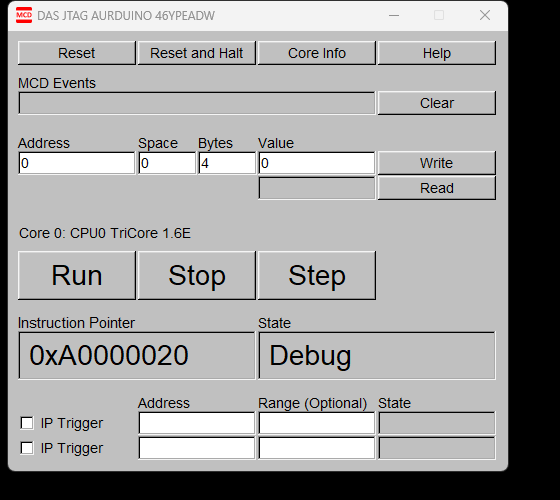
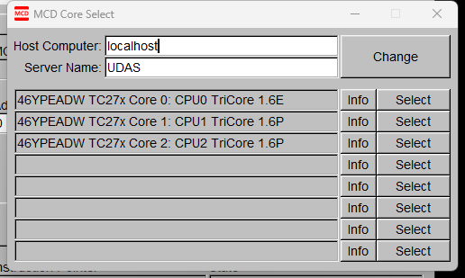
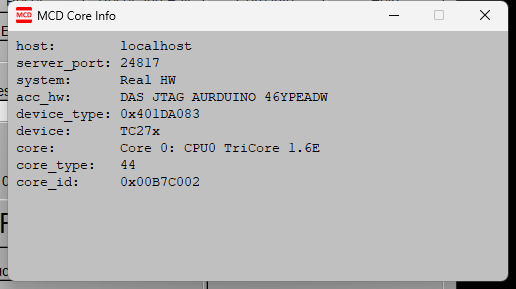
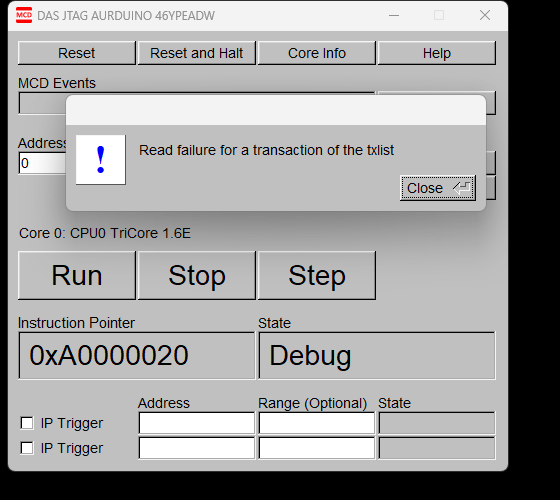
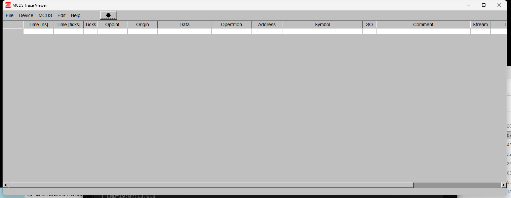
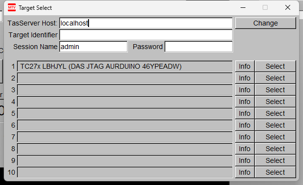
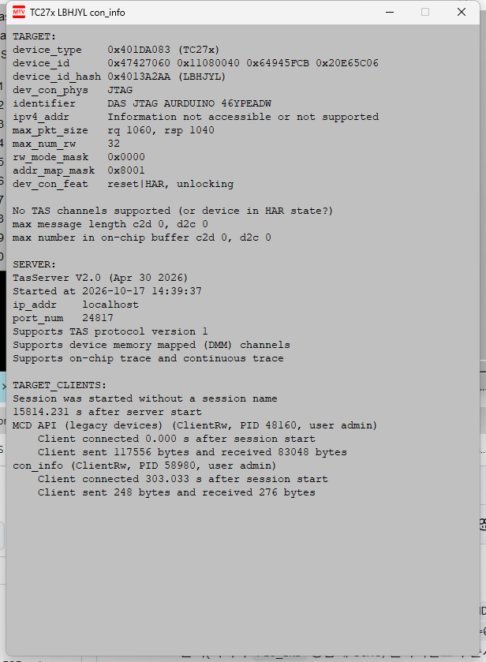
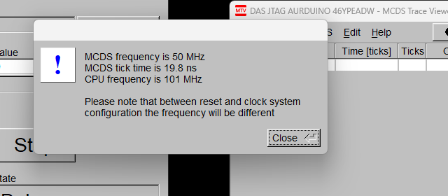
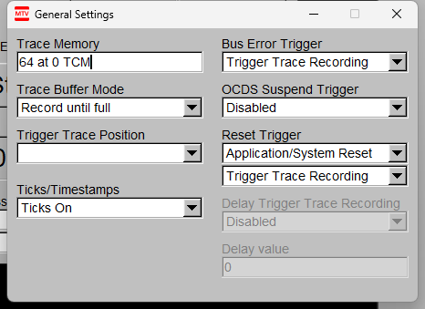
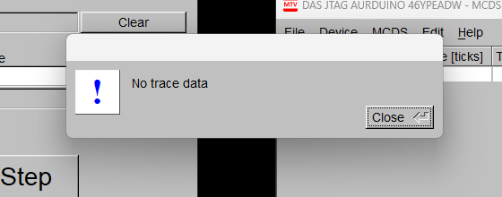

# DAS 네이티브 도구 분석 — MCD Basic Client & MCDS Trace Viewer

> 2026-10-17 · 대상: `C:\Program Files\DAS64\clients\mcd_basic_client.exe`(PID 48160) / `mcds_trace_viewer.exe`(PID 58980)
> 방법: UI 워크스루(스크린샷 `mcds/crop_*.png`) + **포트 하이재킹 프록시**로 24817 전 세션 캡처 후 해독
> 프로토콜 바이트 해설: [TAS_PROTOCOL_CAPTURE.md](TAS_PROTOCOL_CAPTURE.md) §8 · DLL 내부 구조: [DAS_DLL_ANALYSIS.md](DAS_DLL_ANALYSIS.md)
> 실기: TC27x + DAS JTAG AURDUINO(`46YPEADW`), TasServer V2.0(localhost:24817, PID 19760)

---

## 0. 요약

- 두 도구 모두 **TasServer(24817) 클라이언트**다. MCD는 코어 상태(PC 등) 상시 폴링 + RW 패널, MTV는 MCDS 트레이스 열람 도구다.
- 캡처 전 구간에서 **타깃 상태 변경 트래픽이 없었다**: 모든 DEVICE_CONNECT가 `opt=0`(리셋/정지 없음), Reset/Stop/Run 호출 0건.
- MCD: 코어 선택 후 **3프레임 사이클(≈225 ms, 13.3 msg/s)** 로 상시 폴링 — 맵15 내부 레지스터 2종 + **CPU PC**(맵0 `0xF881_FE08`, UI의 Instruction Pointer `0xA0000020`과 일치).
- MTV: Target Select 열거 동안 GT 폴링 + 소형 세션 반복 → 선택 후 트레이스 레지스터 4계열 폴링. 빈도 안내를 닫은 시점(19:12:46경)부터 **≥110 msg/s** 고속 폴링으로 전환.
- SESSION_START 특이 동작: **세션명이 비어있지 않으면 서버가 err=0x38로 거부**(빈 이름으로 재시도하면 성공). MTV Target Select의 `Session Name: admin` 기본값이 이 경로를 탄다.
- Info 버튼은 별도 연결로 **GET_CLIENTS**(접속 클라이언트 목록·송수신 바이트 통계)를 조회해 창에 표시한다.
- 주의: 상시 폴링이 있는 장수명 연결은 `timeline.log` 라인이 중도 누락될 수 있다(**bin이 정본**) — §4.2.

## 1. 공통

### 1.1 캡처 규모 (18:59:24.971 ~ 19:15:02.820)

| 항목 | 값 |
|---|---|
| TCP 연결 | 3,662개 |
| c2s | 39,382 메시지 / 1,333,244 B |
| s2c | 39,382 메시지 / 2,120,928 B |
| 원본 | `mcds/tas_capture/` (c2s_*.bin / s2c_*.bin = 정본, timeline.log) |
| 해독 리포트 | `mcds/native_report/` (전량 연결 요약 + detail 106건) |

### 1.2 클라이언트 식별 (SERVER_CONNECT의 이름 필드)

| 도구/기능 | 서버에 제출한 이름 | PID |
|---|---|---|
| mcd_basic_client | `MCD API (legacy devices)` | 48160 |
| mcds_trace_viewer — 메인 세션 | `MCDS recorder` | 58980 |
| mcds_trace_viewer — Target Select 열거 | `Target Select` | 58980 |
| mcds_trace_viewer — Info | `con_info` | 58980 |

## 2. MCD Basic Client (`mcd_basic_client.exe`)

### 2.1 화면 구성

- 메인 창(제목 `DAS JTAG AURDUINO 46YPEADW`): 상단 **Reset | Reset and Halt | Core Info | Help**, `MCD Events`(로그)+`Clear`,
  RW 패널 **Address / Space / Bytes / Value + Write | Read**, 코어 패널 `Core 0: CPU0 TriCore 1.6E` + **Run | Stop | Step**,
  `Instruction Pointer: 0xA0000020`, `State: Debug`, IP Trigger 2개(Address/Range).
  
- Core Select 대화상자: Host Computer `localhost`, Server Name `UDAS`, Change 버튼, 코어 목록 3개
  (Core 0: CPU0 TriCore 1.6E / Core 1: CPU1 TriCore 1.6P / Core 2: CPU2 TriCore 1.6P) — 행마다 Info | Select.
  
- Core Info 대화상자: system `Real HW`, acc_hw `DAS JTAG AURDUINO 46YPEADW`, device_type `0x401DA083`, device `TC27x`,
  core `Core 0: CPU0 TriCore 1.6E`, core_type `44`, core_id `0x00B7C002`, server_port `24817`.
  
- Read 실패 모달: `Read failure for a transaction of the txlist`.
  

### 2.2 시작/열거 동작 (Core Select 목록 채우기)

- 18:59:25~19:03:07(약 226초) 동안 **연결 2,918개**(초당 ~13개)를 생성/폐기하며 타깃·정보 질의를 반복했다(대부분 수명 0.1~1초).
- 질의 아키타입(관측 대표):

| c2s 크기 | 메시지 구성 | 예 |
|---|---|---|
| 60 B | SERVER_CONNECT만 | conn 424, 425 |
| 68 B | +GET_TARGETS | (혼재) |
| 220 B | +SESSION_START+PL0(문자열 블록 @0/@8000)+GET_TARGETS | conn 429 |
| 248 B | SESSION_START+PL0(문자열 블록)×2 | conn 431 |
| 212~372 B | 위 혼합 변형들 | conn 438, 440, 444 … |
| 380 B | **풀 프로브**: SVR+GT+SS+PL0(@0/@8000)+PING+PL0(@D000)+PL0(@C00B0000, 실패)+RD32@0x000C0100=0x61A80(400000)+RD32@0xC0020000=0x64(100)+PL0(@0/@8000) 재읽기 | conn 426 |

- `0xC00B0000` 블록 읽기는 PL0_DATA 오류로 끝난다 — 정상적인 능력 탐색 패턴(오류 무시하고 진행).
- GET_TARGETS 응답의 `nclient`(동시 세션 수)가 열거 중 0~2로 변동 — 동시 질의 세션 수를 반영.

### 2.3 코어 선택 후 세션 (conn 3341, 19:03:11.19~)

- 선택(19:03:07.849) 직후 열거가 멈추고 장수명 세션 1개로 전환. 수립 시퀀스(바이트 해설은 TAS_PROTOCOL_CAPTURE.md §8.3.2):

| # | 메시지 | 내용 |
|---|---|---|
| 0 | SERVER_CONNECT | name `MCD API (legacy devices)`, user `admin`, pid 48160 |
| 1 | GET_TARGETS | 타깃 1개 확인 |
| 2 | SESSION_START | identifier `DAS JTAG AURDUINO 46YPEADW`, sname·패스워드 공백, ctype=1 |
| 3 | PING (0xA2) | — |
| 4~6 | PL0 RDBLK | con_info 문자열 블록(@D000/@0/@8000, @0+@8000 중복 1회) |
| 7 | SET_DEVICE_KEY (0xAD) | 데이터 u32=1 (challenge=0 서버라 검증 없음) |
| 8 | DEVICE_CONNECT | **opt=0x0000(리셋/정지 없음)** → rsp device_type `0x401DA083` |
| 9 | PL0 RDBLK | 문자열 블록 재확인(세션 중 3번째) |
| 10~14 | PL0 RW | 초기화: RD32 `0xF0000480`=0x00080001, RD32 `0xF0000490`=0; WR32 `0xF0000498`←0x2, `0xF0000494`←0x8000003F, `0xF0000420`←0x00000102 |

- 이후 프록시 정지(19:15:02)까지 폴링 지속. MCD 앱은 연결 단절(프록시 정지) 시점에 종료됐다.

### 2.4 상시 폴링 — 3프레임 사이클

~225 ms 주기(≈4.4 Hz, 13.3 msg/s). 원문(TAS_PROTOCOL_CAPTURE.md §8.3.3):

| 순서 | 트랜잭션 | 읽은 값 |
|---|---|---|
| m1 | 맵15: RD32 `0x000C8200` **×2회** | 0x400, 0x400 (동일 주소 2회 — 클라이언트 구현 특성) |
| m2 | 맵15: WR64 `0x000A8000` ← `0x0000800000008000` | ack (유일한 반복 쓰기) |
| m3 | 맵0: RD32 `0xF881FE08` | `0xA0000020` = **CPU PC** (UI Instruction Pointer와 일치) |

- 최초 회차만 m3에 RD32 `0xF881FD00`=0x00001013 추가(4프레임).
- 0x8200/0x8000(맵15)·0xF881 베이스는 디버그/내부 영역으로 추정(명칭 미확정, §4.3).

### 2.5 Read/Write 패널 — 실패 재현 포함

- UI 기본값: Address `0`, Space `0`, Bytes `4` (= 맵0 주소 0을 4바이트 읽기).
- 19:03:38.034 `Read` 실행 → 다음 폴링 프레임에 `RD32 @0x0000` 1건 추가 →
  서버 err=**0x8D**(PL0_DATA) → 모달 `Read failure for a transaction of the txlist` 표시,
  폴링이 19:04:05.156까지 **약 26초 정지** 후 자동 재개 (타임라인상 폴링 공백으로 관측).
- 해석: 실기(TC27x)에서 맵0 주소 0은 접근 불가 — 도구는 오류를 박스로 알리고 폴링을 계속한다.
- Write / Run / Stop / Step / Reset 버튼은 이번 캡처에서 사용하지 않음(트래픽 0건) → **타깃 상태 변경 없음** 확인.
- Core Info(19:04:06)·Help 메뉴는 서버 트래픽을 추가로 발생시키지 않았다(문자열 블록 캐시 사용 추정).

## 3. MCDS Trace Viewer (`mcds_trace_viewer.exe`)

### 3.1 화면 구성

- 메인: 제목 `MCDS Trace Viewer`, 메뉴 File/Device/MCDS/Edit/Help, 녹화(●) 버튼,
  트레이스 표 컬럼(Time [ns], Time [ticks], Ticks, Opcode, Origin, Data, Operation, Address, Symbol, SO, Comment, Stream …) — 캡처 시점 비어 있음.
  
- Target Select: TasServer Host `localhost`(+Change), Target Identifier, **Session Name `admin`**, Password;
  타깃 행 `TC27x LBHJYL (DAS JTAG AURDUINO 46YPEADW)` + Info | Select.
  
- Info 창(§3.7) / 빈도 안내(`MCDS frequency is 50 MHz / tick 19.8 ns / CPU 101 MHz`) / General Settings(§3.6).
    

### 3.2 Target Select 열거 (미선택 상태)

- 19:07:44.7~19:11:37.3: 연결 3342에서 **GET_TARGETS ×1,110**(~4.8회/s) 반복 — 목록 갱신용.
- 동시에 ~0.6초 주기 **소형 세션(~740개)**: SERVER_CONNECT+SESSION_START+DEVICE_CONNECT 후 즉시 종료 — 타깃 상세 조회용.
  (각 세션은 서버 핸들을 재사용 — 3343 등은 0x85.)

### 3.3 선택 후 세션 — `Session Name: admin` 거부 → 재시도 (conn 4085, 19:11:37.36~)

- 흐름: SVR(`MCDS recorder`) → GT → SS(**sname=`admin`**) → **err=0x38 거부** → SS(**sname=빈 값**) → OK → DC(`opt=0`).
- Target Select의 Session Name 필드 기본값이 `admin`이므로 그대로 전송됐고, 서버가 명명 세션을 거부하자 빈 이름으로 자동 재시도해 성공했다.
- 이어서 능력 프로브: 맵1 `0xF00E8000` 읽기 → PL0_DATA 오류(무시).

### 3.4 트레이스 레지스터 폴링

| 계열 | 트랜잭션 | 관측 값 | 횟수 |
|---|---|---|---|
| m_a | 맵0: B32 `0xF003` + RD32 `0xF003601C` | `0x0002020F`(고정) | 583 |
| m_b | 맵15: B32 `0x5000` + RD64 `0x50000090` | 64비트 증가 카운터 — 첫 `0x3CCC66A52` → 끝 `0x3D90410A3` | **11,660** (END=1/3 변형 각 5,830) |
| m_c | 맵0: B32 `0xF000` + RD32 `0xF0000010` | 32비트 증가 카운터 — 첫 `0x9C0215B5`…(32비트 랩 1회)…끝 `0x05AF23DD` | 5,830 |
| m_d | 맵0: B32 `0xF003` + RD32 `0xF0036034` / `0xF0036040` | `0x2211` / `0x2` | 548 ×2 |

- 속도: 19:11:37~19:12:44 구간은 10초 버킷당 132~141메시지(~14 msg/s) →
  빈도 안내를 닫은 19:12:46경부터 1,100~1,141/10초(**≥110 msg/s**) 유지(캡처 종료까지).
- 카운터 시간기저(관측): m_b ≈ 1.08~1.12×10⁶ 증가/s(µs급 근사), m_c ≈ 8.0×10⁶ 증가/s.
  도구가 표시하는 "MCDS 50 MHz / 19.8 ns tick / CPU 101 MHz"와는 별개 소스로 보임(정확 기준 미확정 — §4.3).
- 트레이스 표의 `Time [ns] / Time [ticks]` 열이 이 카운터 계열과 연동되는 것으로 추정.

### 3.5 기록과 "No trace data"

- Alt+R(19:13:37.892)로 기록 시작(●) → 곧 **`No trace data`** 안내(캡처 종료 시점까지 데이터 없음).
  
- 해석: 타깃 CPU가 `State: Debug`(정지, PC 0xA0000020) — 실행 이벤트가 없어 트레이스 버퍼가 비어 있음.
  MCD 쪽 UI 표시(State: Debug)와 교차 확인. 폴링 자체는 계속됐으므로 **연결/서버 문제가 아니라 트레이스 소스 문제**다.

### 3.6 General Settings 항목(관측값)

Trace Memory `64 at 0 TCM` · Trace Buffer Mode `Record until full` · Trigger Trace Position / Bus Error Trigger `Trigger Trace Recording` /
OCDS Suspend Trigger `Disabled` · Reset Trigger `Application/System Reset` + `Trigger Trace Recording` /
Ticks(Timestamps) `Ticks On` · Delay Trigger Trace Recording `Disabled`(값 0).

### 3.7 Info 창 (GET_CLIENTS 흐름)

- 클릭 시 단명 연결 2개: ① SS(client_type=2) → err=0x20(PL1_CMD_FAILED) ② SS(ctype=1)+**GET_CLIENTS**(타깃 id) → 성공.
- 응답은 클라이언트 레코드(타임스탬프/이름/사용자/PID/flags/송신·수신 바이트) 목록:
  - `MCD API (legacy devices)` … **sent 117,556 / received 82,920 B**(도구 창 표시는 83,048 — 실시간 집계 시점 차)
  - `con_info` … **sent 248 / received 276 B** (해당 연결의 실제 바이트 수와 일치)
- 창 하단 문구 `Session was started without a session name` / `15814.231 s after server start` / `303.033 s after session start` 는
  서버의 세션 시작 시각 정보를 표시한 것(실제 시각과 일치: v2.0 기동 14:39:37 → 19:03:11 세션 = 15,814초).

## 4. 공통 관찰과 함정

### 4.1 핸들·카운터

- 응답의 세션 핸들(con_id)은 동적: MCD 0x84, MTV 0x85, 열거 세션 0x95/0x96 — 단명 세션에서 재사용된다.
- pl1_cnt는 연결별 0xFFC1 시작 +1 카운터(u16 랩 실측: 4085 #68 = 0x0000, 3341 #400 = 0x014B).

### 4.2 로그 절단 함정

- `timeline.log`의 conn 3341 라인은 19:07:44.530 이후 누락되지만, bin 기준으로 **프록시 정지까지 계속 폴링**했다.
  "MCD가 19:07:44에 멈췄다"는 해석은 금물 — 로깅 아티팩트다(TAS_PROTOCOL_CAPTURE.md §8.7).

### 4.3 미확정 사항

- 맵15·`0xF000`·`0xF881`·`0xF0036xxx` 레지스터의 공식 명칭/의미 미확정(디버그·클록 계열로 추정).
- 카운터 시간기저의 정확한 클록(≈1.1 MHz / ≈8 MHz)은 미확정 — 캡처 관측값만 기술.
- 세션명 지정 시 거부(0x38) 규칙이 다른 서버/도구 버전에서도 동일한지는 미확인.

## 부록. 파일·재현

- 스크립트(`mcds/`): `tas_hijack_proxy.py`(포트 하이재킹 캡처), `recon_capture.py`(정찰), `dec_native.py`(전량 해독→`native_report/`),
  `probe_conns.py`·`dump2.py`·`dump3.py`·`seg.py`(표적 덤프), `ui.ps1`(스크린샷 자동화)
- 원본 캡처: `mcds/tas_capture/` (bin = 정본), 리포트: `mcds/native_report/`, 스크린샷: `mcds/crop_*.png`, `mcds/menu_*.png`
- 재현: 하이재킹 프록시 기동 → DAS 도구를 localhost:24817로 조작 → (종료 후) `dec_native.py`로 해독.
- 캡처 종료 시점 상태: 프록시 정지 · tas_server(PID 19760) 실행 중 · mcds_trace_viewer(PID 58980) 실행 중(미접속) · mcd_basic_client 종료.
